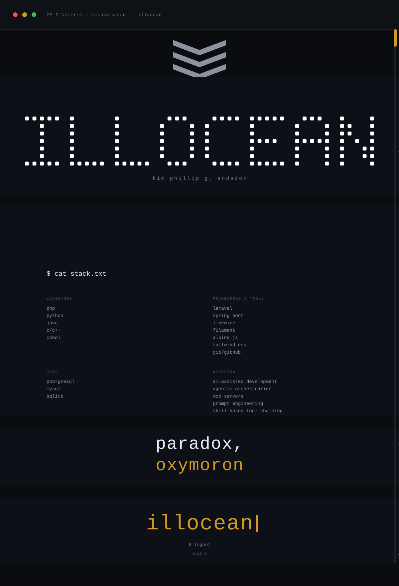

  

  

  
  
  

## I'm building with

**Languages**

**Frameworks & tools**

**Databases**

**AI & workflow**

---

  

<b>📚 what I'm learning right now</b>

- **Agentic orchestration** — chaining MCP servers into autonomous skill workflows.
- **LLMs** — prompt engineering, RAG pipelines, and finetuning.
- **COBOL modernization** — bridging legacy systems to the cloud.

<b>📬 let's connect</b>

- [GitHub — @illocean](https://github.com/illocean)
- [LinkedIn](https://linkedin.com/in/illocean)
- [Email](mailto:illocean@proton.me)

  

