  

  <b>paradox, oxymoron</b> 
  PHP next to COBOL &middot; Spring Boot next to Godot &middot; an MCP server in Java

## in the water

<picture>
  <source media="(prefers-color-scheme: dark)" srcset="./assets/marquee.svg">
  
</picture>

<picture>
  <source media="(prefers-color-scheme: dark)" srcset="./assets/stack.svg">
  
</picture>

 

<table>
<tr>
<td width="30%" align="center" valign="middle">
  
</td>
<td valign="middle">

### now

- Building **lunar-mcp** &mdash; an MCP server that lets coding agents drive Eclipse
- Rebuilding my desktop rituals in **Bakunawa**, a PowerShell disk cleaner
- Keeping a COBOL inventory system alive and well-tested
- Learning in public: every repo here is a course, an idea, or a dare

`open to work` &middot; `paranaque, ph` &middot; `remote &gt; hybrid &gt; on-site`

</td>
</tr>
</table>

<b>the whole harbor</b> &mdash; every project, one line each

 

| project | what it is | written in |
| --- | --- | --- |
| [gif-terminal](https://github.com/illocean/gif-terminal) | animated terminal GIF for this profile, stats included | Python |
| [lunar-mcp](https://github.com/illocean/lunar-mcp) | MCP server for the Eclipse IDE | Java |
| [Bakunawa](https://github.com/illocean/Bakunawa) | preview-then-delete Windows disk cleaner | PowerShell |
| [yslep-service-ledger](https://github.com/illocean/yslep-service-ledger) | service-hour tracking, Obsidian vault included | PHP |
| [auto-repair-shop-management-system](https://github.com/illocean/auto-repair-shop-management-system) | shop floor, end to end | PHP |
| [HCI-Project](https://github.com/illocean/HCI-Project) | first-person 2.5D roguelike | C#, Godot 4.6 |
| [MorphosPowerPointAddIn](https://github.com/illocean/MorphosPowerPointAddIn) | font and color cleanup for PowerPoint | C# |
| [birthday-greet](https://github.com/illocean/birthday-greet) | scroll-driven birthday site in five scenes | TypeScript |
| [DisQuest](https://github.com/illocean/DisQuest) | automates Discord quests, Vesktop included | TypeScript |
| [spicetify-melior](https://github.com/illocean/spicetify-melior) | finds every playlist that collides | JavaScript |
| [spicetify-symphona](https://github.com/illocean/spicetify-symphona) | routed playlist intersections | JavaScript |
| [Inventory-and-Sales-Management-System](https://github.com/illocean/Inventory-and-Sales-Management-System) | indexed and sequential file handling | COBOL |
| [JavaWorkplace](https://github.com/illocean/JavaWorkplace) | advanced programming coursework and app projects | Java |
| [Basic-Campus-Ledger-on-Laravel-with-Postgresql](https://github.com/illocean/Basic-Campus-Ledger-on-Laravel-with-Postgresql) | information management campus ledger | Blade |
| [WebDev1](https://github.com/illocean/WebDev1) | second-year web development | Blade |
| [bi_project](https://github.com/illocean/bi_project) | business intelligence coursework | PHP |

hand-drawn SVG &middot; every wave is a path &middot; every path is an <code>&lt;animate&gt;</code>

